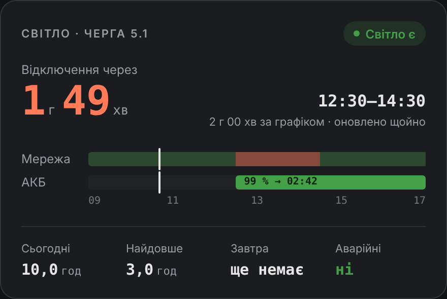
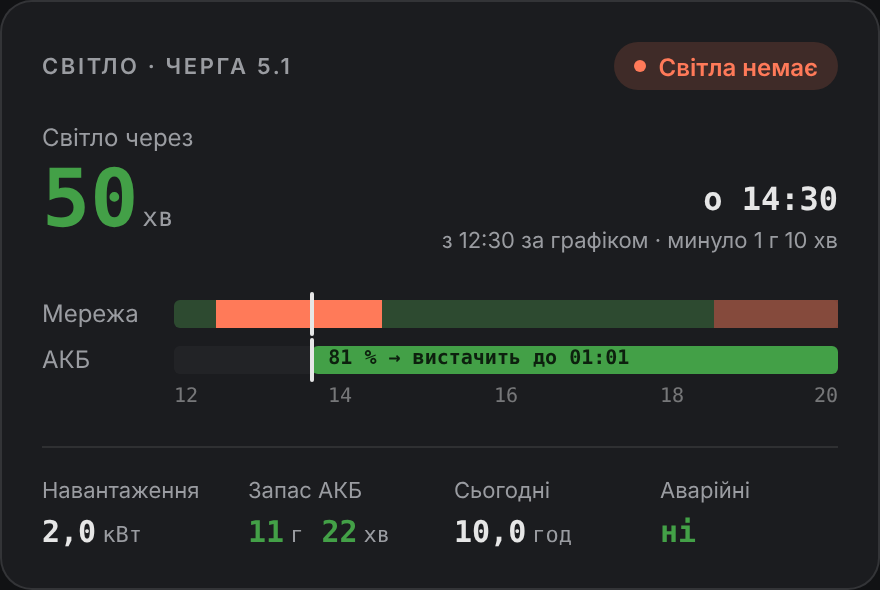
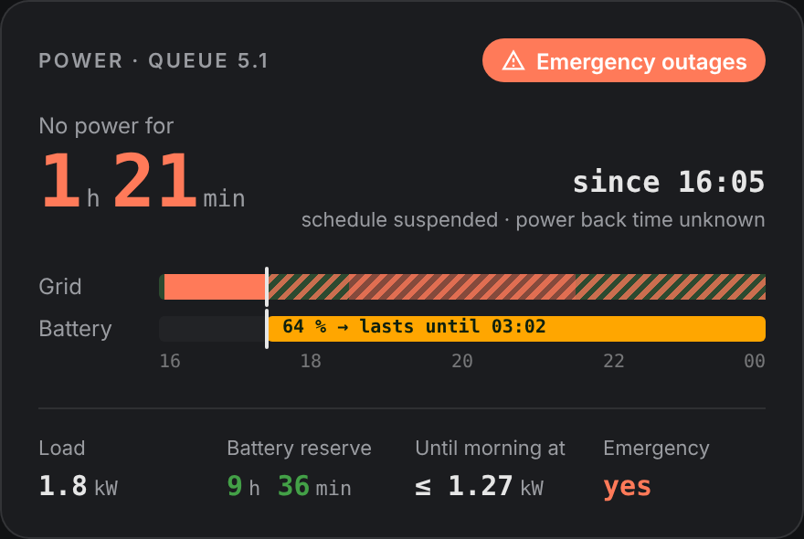
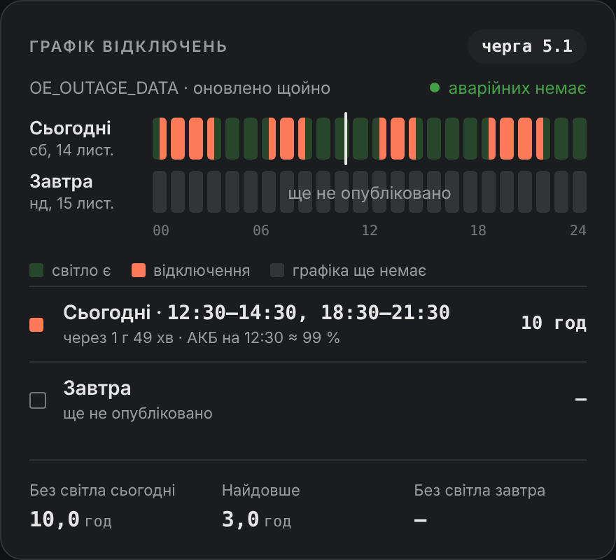
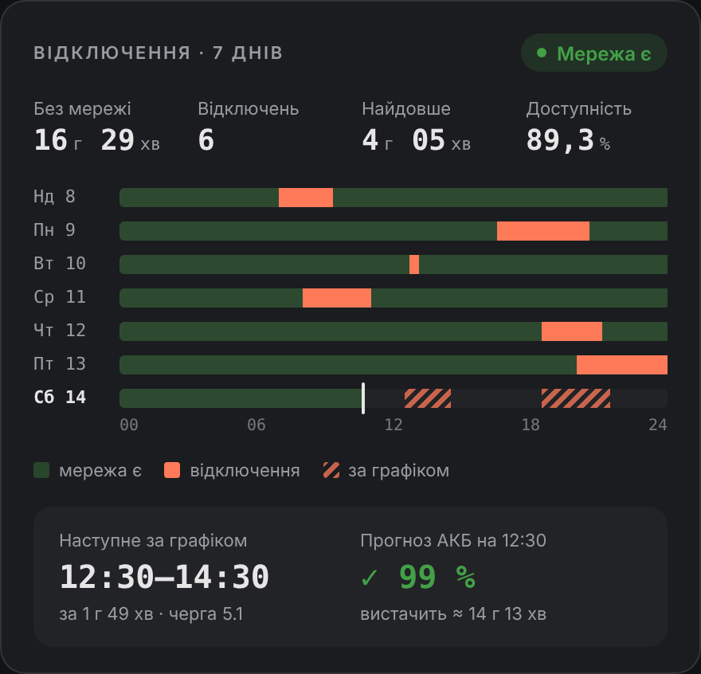
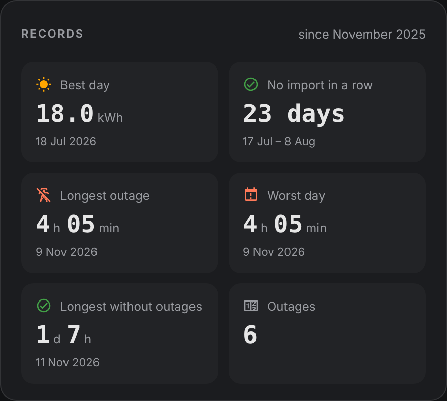
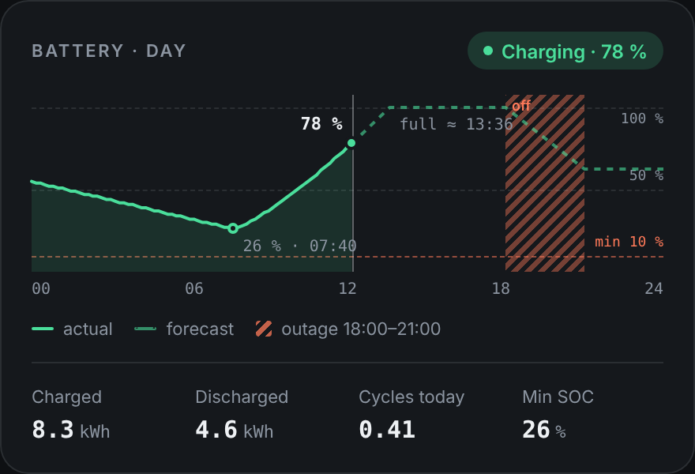
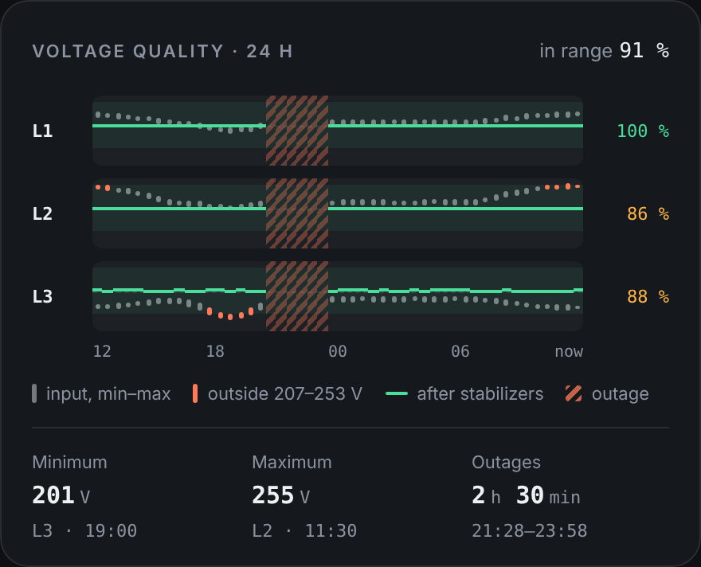
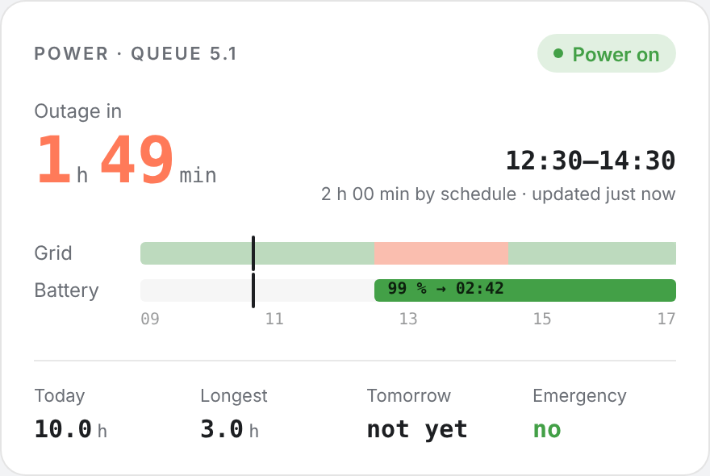
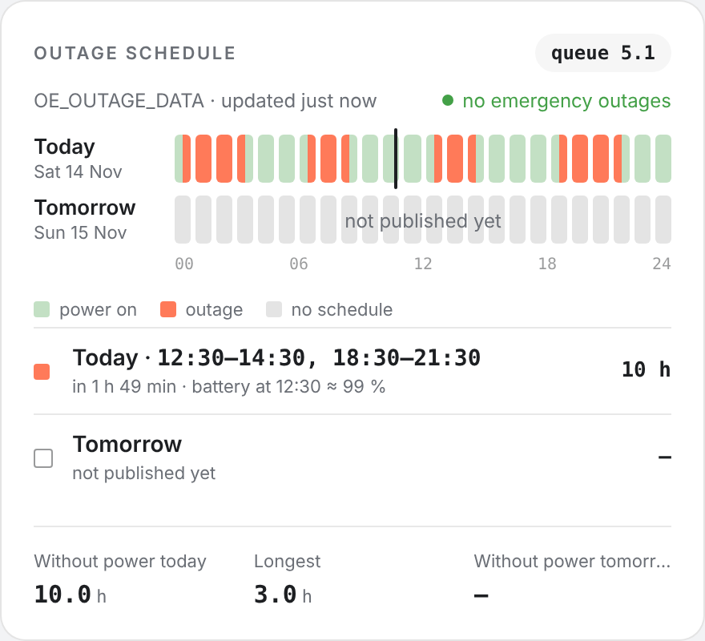

# Blackout

[](https://hacs.xyz/docs/faq/custom_repositories)
[](https://github.com/RobinCK/blackout/actions/workflows/tests.yml)
[](https://github.com/RobinCK/blackout/actions/workflows/validate.yml)
[](LICENSE)

A Home Assistant integration for planned and emergency power outages in Ukraine. It reads outage
schedules for 21 regions, the grid state of every region from Ukrenergo and, optionally, the actual
grid presence from your inverter. It keeps the history of schedules and real outages, so dashboard
cards can show the last days, records and availability.

Dashboard cards come with the integration: install one thing and six cards appear in the card
picker.

| Power status | Scheduled outage | Emergency outages |
| --- | --- | --- |
|  |  |  |

| Schedule | Last 7 days | Records |
| --- | --- | --- |
|  |  |  |

| Battery today | Voltage quality |
| --- | --- |
|  |  |

| Light theme, English | |
| --- | --- |
|  |  |

## Features

- Any number of queues in one integration, in the same or in different regions.
- Schedules as 48 half-hour slots for today and tomorrow, with `on`, `off`, `possible` and
  `unknown` states.
- Sources in order of preference for each region, with automatic fallback when a source is down or
  has no schedule for today.
- Emergency outages from the Ukrenergo grid state by region, the YASNO day status and the
  svitlo.live flag (each one can be turned off).
- Actual outages from any grid entity: a binary sensor, a voltage sensor or a text sensor of the
  inverter. The log is filled from the recorder history on first setup.
- History of schedules (with every published version) and of actual outages in Home Assistant
  storage, with configurable retention.
- Calendar of scheduled outages, events when a schedule is published or changed.
- A websocket API that gives cards everything about a queue in one call.
- Four dashboard cards (status, schedule, last days, records) with a visual editor, light and dark
  themes, English and Ukrainian texts and your own text and color overrides.
- English and Ukrainian translations.

## Regions and sources

| Region | Operator | Schedule sources (in order) |
| --- | --- | --- |
| Kyiv | DTEK KEM | YASNO API, outage-data-ua, svitlo.live |
| Kyiv Oblast | DTEK KREM | outage-data-ua, svitlo.live |
| Dnipropetrovsk Oblast | DTEK DnEM | YASNO API, outage-data-ua, svitlo.live |
| Dnipropetrovsk Oblast | CEK | YASNO API, svitlo.live |
| Odesa Oblast | DTEK OEM | outage-data-ua, svitlo.live |
| Cherkasy, Chernihiv, Ivano-Frankivsk, Kharkiv, Khmelnytskyi, Lviv, Poltava, Rivne, Ternopil, Zakarpattia, Zhytomyr | oblenergo | OE_OUTAGE_DATA, svitlo.live |
| Zaporizhzhia Oblast | Zaporizhzhiaoblenergo | gpv-zoe-zaporizhzhia, OE_OUTAGE_DATA, svitlo.live |
| Vinnytsia Oblast | Vinnytsiaoblenergo | gpv-voe-vinnytsia mirrors |
| Chernivtsi Oblast | Chernivtsioblenergo | svitlo.live (groups 1–12) |
| Sumy Oblast | Sumyoblenergo | svitlo.live |
| Mykolaiv Oblast | Mykolaivoblenergo | official API (off.energy.mk.ua) |
| Volyn, Kirovohrad | oblenergo | grid state only, no schedule source yet |

The grid state of every region comes from
[lasercat12/ua-power-status](https://github.com/lasercat12/ua-power-status), an unofficial mirror of
the Ukrenergo app: `normal`, `shortage`, `outage_schedules`, `emergency_outages`, `grid_damage`.

Mirrors: [Baskerville42/outage-data-ua](https://github.com/Baskerville42/outage-data-ua),
[yaroslav2901/OE_OUTAGE_DATA](https://github.com/yaroslav2901/OE_OUTAGE_DATA),
[milkmann/gpv-zoe-zaporizhzhia](https://github.com/milkmann/gpv-zoe-zaporizhzhia),
[olnet93/gpv-voe-vinnytsia](https://github.com/olnet93/gpv-voe-vinnytsia),
[svitlo.live](https://svitlo.live). All of them are unofficial: the only binding schedule is the one
your operator publishes, and outages are possible outside of it.

## Installation

### HACS

[](https://my.home-assistant.io/redirect/hacs_repository/?owner=RobinCK&repository=blackout&category=integration)

1. Open the repository in HACS with the button above, or add it by hand: HACS → menu →
   **Custom repositories**, `https://github.com/RobinCK/blackout`, category **Integration**.
2. Install **Blackout** and restart Home Assistant.
3. Add the integration:

   [](https://my.home-assistant.io/redirect/config_flow_start/?domain=blackout)

The cards are served by the integration and added to every dashboard automatically, there is no
separate Lovelace resource to install. Refresh the browser after an update.

### Manual

Copy `custom_components/blackout` to `config/custom_components` and restart Home Assistant.

## Configuration

1. **Settings → Devices & services → Add integration → Blackout.** Choose the region and the queue
   of your first address.
2. Add more queues with the **Add queue** button of the integration. Each queue is a device with its
   own entities.
3. Optional for every queue: the **grid presence entity**. Use a binary sensor (`on` = grid present),
   a voltage sensor (grid is present at or above the threshold, 150 V by default) or a text sensor
   (`on`, `connected`, `online`…). With the Sunsynk/Deye add-on this is
   `binary_sensor.<prefix>_grid_connected` or `sensor.<prefix>_grid_l1_voltage`.
4. The queue settings (name, grid entity, threshold) can be changed with **Reconfigure** on the queue.

Integration options:

| Option | Default | |
| --- | --- | --- |
| Language of entity names | English | English, Українська or the Home Assistant language; entity IDs are always created from English names |
| Update interval | 5 min | how often sources are asked; shared requests for all queues |
| Keep schedules | 90 days | schedule history |
| Keep outage log | 365 days | actual outages |
| Ignore outages shorter than | 60 s | flapping of the grid entity |
| Emergency outage sources | Ukrenergo, YASNO | svitlo.live can be added |

## Entities

Every queue has a device with these entities. Names are in English by default, see the **Language of
entity names** option.

| Entity | |
| --- | --- |
| `sensor.<queue>_power_status` | `power_on`, `scheduled_outage`, `possible_outage`, `emergency`, `unscheduled_outage`, `unknown`; attributes `today` and `tomorrow` (48 slot codes), day statuses, region, group, source |
| `sensor.<queue>_next_outage` | start of the next scheduled outage |
| `sensor.<queue>_power_back` | end of the current or next scheduled outage |
| `sensor.<queue>_outage_today`, `_outage_tomorrow`, `_longest_outage_today` | hours by schedule |
| `sensor.<queue>_grid_status_in_region` | Ukrenergo grid state of the region |
| `sensor.<queue>_schedule_updated` | when the operator updated the schedule (diagnostic) |
| `binary_sensor.<queue>_scheduled_outage_now` | on during a scheduled outage |
| `binary_sensor.<queue>_possible_outage_now` | on during a possible outage (disabled by default) |
| `binary_sensor.<queue>_emergency_outages` | on while emergency outages apply |
| `binary_sensor.<queue>_data_source` | whether the last update succeeded, with the source name (diagnostic) |
| `calendar.<queue>_outage_schedule` | scheduled outages, history included |
| `event.<queue>_schedule` | `schedule_published`, `schedule_changed` with `date`, `slots`, `outages`, `hours` |

With a grid entity: `binary_sensor.<queue>_grid`, `sensor.<queue>_no_power_since`,
`sensor.<queue>_actual_outage_today` and `sensor.<queue>_availability_7_days`.

Slot codes in attributes and events: `1` power on, `0` outage, `?` possible outage, `-` unknown.

## Cards

Every card takes `entity`: any entity of a Blackout queue, usually `sensor.<queue>_power_status`
(optional for the battery and voltage cards).
Texts are in English and Ukrainian and follow the language of your Home Assistant profile; set
`language` on a card to fix it.

Hover over a bar (or tap it on a phone) to see the half hour under the pointer, the scheduled
window it belongs to and, with a grid entity, whether there was power at that time.

### Common options

| Option | Default | |
| --- | --- | --- |
| `entity` | — | entity of a Blackout queue |
| `title` | per card | header text; the header is hidden with `show_header: false` |
| `show_header` | `true` | |
| `language` | profile language | `en` or `uk` |
| `time_zone` | `Europe/Kyiv` | time zone of the times shown |
| `labels` | — | your own texts by key, for example `hero.outage_in: Off in` (keys are in `frontend/src/i18n/en.ts`) |
| `colors` | theme | `on`, `off`, `possible`, `emergency`, `battery`, `unknown` (any CSS color) |
| `tap_action` | `more-info` | header tap: `more-info` or `none` |

Colors can also be set in a theme with the `--blackout-on-color`, `--blackout-off-color`,
`--blackout-possible-color`, `--blackout-emergency-color`, `--blackout-battery-color`,
`--blackout-unknown-color` and `--blackout-mono-font` variables.

### Battery

The status, schedule and week cards show a battery forecast when `battery` is set. With the
Sunsynk/Deye add-on:

```yaml
battery:
  soc: sensor.deye_master_battery_soc
  power: sensor.deye_master_battery_power
  load: sensor.deye_master_load_power
  capacity: 32 # kWh, or an entity in kWh
  reserve: 10 # % that is never used
  power_positive: discharge # what a positive battery power means
  morning_hour: 7 # for "until morning at"
```

The forecast assumes the current battery power until the outage starts (or until power comes back,
if it is off now) and the current load during the outage. `soc` and `capacity` are required.

| Card | Shows | Uses |
| --- | --- | --- |
| Status | forecast on the timeline, battery statistics | all options |
| Schedule | level at the start of each upcoming outage window | `soc`, `power`, `capacity`, `reserve`, `power_positive` |
| Week | level and runtime for the next outage | all options except `morning_hour` |
| Battery | the day with a forecast to midnight, charged and discharged energy, cycles | all options except `morning_hour`; `soc` alone draws the day |

The visual editor shows only the options that change the card: for example, the battery section of
the schedule card disappears when `show_windows` is off, and the title when the header is hidden.

### Status card

```yaml
type: custom:blackout-status-card
entity: sensor.home_power_status
battery: ...
```

| Option | Default | |
| --- | --- | --- |
| `show_badge` | `true` | status badge in the header |
| `show_timeline` | `true` | grid and battery rows |
| `timeline_hours` | `8` | length of the timeline |
| `timeline_offset` | `1` | hours shown before now |
| `show_stats` | `true` | statistics at the bottom |
| `stats` | by state | a list, or lists by state: `power_on`, `outage`, `emergency` |

Statistics: `today`, `longest`, `tomorrow`, `emergency`, `load`, `battery_reserve`,
`battery_at_start`, `until_morning`, `actual_today`, `availability`, `region`, `next_outage`,
`power_back`, `source`.

```yaml
stats:
  power_on: [today, longest, tomorrow, emergency]
  outage: [load, battery_reserve, today, emergency]
  emergency: [load, battery_reserve, until_morning, emergency]
```

### Schedule card

```yaml
type: custom:blackout-schedule-card
entity: sensor.home_power_status
```

| Option | Default | |
| --- | --- | --- |
| `days` | `[today, tomorrow]` | rows |
| `show_source` | `true` | source and emergency line |
| `show_now` | `true` | current time marker |
| `show_legend` | `true` | |
| `show_windows` | `true` | outage windows of each day |
| `show_totals` | `true` | hours without power |
| `battery` | — | battery level at the next outage |

### Week card

```yaml
type: custom:blackout-week-card
entity: sensor.home_power_status
days: 7
```

| Option | Default | |
| --- | --- | --- |
| `days` | `7` | 1–90 |
| `show_badge` | `true` | grid state badge |
| `show_stats` | `true` | without grid, outages, longest, availability |
| `show_schedule` | `true` | scheduled outages: ahead, and past ones when power stayed on |
| `show_legend` | `true` | |
| `show_next` | `true` | next outage and battery forecast |
| `battery` | — | |

With a grid entity, solid bars are actual outages, hatching on a dark track is the schedule still ahead and
hatching on green marks scheduled time when the power stayed on. The status card timeline marks the
past part of a scheduled outage the same way. Without a grid entity the card shows the schedule of
each day instead of actual outages.

### Records card

```yaml
type: custom:blackout-records-card
entity: sensor.home_power_status
since: since November 2025
items:
  - type: statistic
    entity: sensor.deye_master_day_pv_energy
    label: Best day
    icon: mdi:white-balance-sunny
    period: day
    value: max
  - type: statistic
    entity: sensor.deye_master_pv_power
    label: Peak PV power
    period: hour
    value: max
    scale: 0.001
    unit: kW
  - type: statistic
    entity: sensor.deye_master_load_power
    label: Lowest night base
    icon: mdi:weather-night
    period: hour
    value: mean
    stat: min
    hours: [1, 5]
    decimals: 0
  - type: streak
    entity: sensor.deye_master_day_grid_import
    label: No import in a row
    value: max
    below: 0.5
  - type: longest_outage
  - type: longest_power_streak
```

| Option | Default | |
| --- | --- | --- |
| `since` | — | text at the right of the header |
| `columns` | `2` | |
| `items` | outage records | see below |

Item types:

- `longest_outage`, `longest_power_streak`, `current_power_streak`, `worst_day`, `outage_count`:
  from the outage log of the queue (needs `entity` and a grid entity on the queue).
- `statistic`: the highest (`stat: max`) or lowest (`stat: min`) value of a long-term statistic of
  any entity. `period`: `5minute`, `hour`, `day`, `week`, `month`; `value`: `change`, `max`, `mean`,
  `min`, `sum`, `state`; `days` back (365); `hours: [from, to]` to look only at some hours; `unit`,
  `decimals`, `scale`, `date_format` (`datetime`, `day`, `month`).
- `streak`: the longest run of days whose `value` is `below` and/or `above` a limit.

Every item takes `label`, `icon` and `color`.

### Battery card

The state of charge since midnight, a forecast to midnight with the outages of the schedule, the
lowest charge of the day, charged and discharged energy and cycles.

```yaml
type: custom:blackout-battery-card
entity: sensor.home_power_status
battery:
  soc: sensor.deye_master_battery_soc
  power: sensor.deye_master_battery_power
  load: sensor.deye_master_load_power
  capacity: 16
  reserve: 10
```

`battery` takes the options of the [Battery](#battery) section. `soc` is required; `capacity` adds
the energy, cycles and the forecast. Energy and cycles come from the changes of the state of charge.
`entity` is optional: with a queue the chart shows today's outages and the forecast runs the load
from the battery during them.

### Voltage card

Input voltage of every phase over the last 24 hours by half hours: the range of each half hour,
half hours outside the limits, the voltage after the stabilizers and the outages.

```yaml
type: custom:blackout-voltage-card
entity: sensor.home_power_status
phases:
  - input: sensor.house_voltage_l1
    output: sensor.stabilized_voltage_l1
  - input: sensor.house_voltage_l2
    output: sensor.stabilized_voltage_l2
  - input: sensor.house_voltage_l3
    output: sensor.stabilized_voltage_l3
```

| Option | Default | |
| --- | --- | --- |
| `phases` | — | up to three phases: `input` voltage and optional `output` after the stabilizers |
| `voltage_min` | `207` | lowest normal voltage, V |
| `voltage_max` | `253` | highest normal voltage, V |

The sensors need long-term statistics (`state_class: measurement`): the card reads their 5-minute
minimum, maximum and mean. `entity` is optional and adds the outages of the queue.

## Websocket API

`blackout/queues` lists the queues with their status entity.

`blackout/queue` with `entity_id` (any entity of a queue) and `days` (1–90, default 7) returns:

```json
{
  "queue": { "title": "Home", "region": "cherkasy", "operator": "Cherkasyoblenergo", "group": "5.1", "has_schedule": true, "grid_entity": "binary_sensor.deye_master_grid_connected" },
  "now": "2026-11-14T10:00:00+02:00",
  "slot_minutes": 30,
  "status": "power_on",
  "emergency": false,
  "region_status": { "status": "shortage", "since": "…", "period_end": "…" },
  "current": null,
  "next": { "start": "…", "end": "…", "possible": false },
  "next_possible": { "start": "…", "end": "…", "possible": true },
  "next_power_on": "…",
  "grid": { "present": true, "since": "…" },
  "source": { "name": "OE_OUTAGE_DATA", "ok": true, "last_success": "…", "last_error": null, "fetched_at": "…" },
  "days": [
    { "date": "2026-11-14", "status": "schedule", "slots": ["on", "off", "…"], "updated_at": "…", "versions": 2, "outage_hours": 10, "possible_hours": 0, "longest_hours": 3, "actual": [{ "start": "…", "end": "…", "hours": 1.5 }], "actual_hours": 1.5 }
  ],
  "summary": { "days": 7, "actual_hours": 14.3, "count": 6, "longest": { "start": "…", "end": "…", "hours": 4.1 }, "availability": 91.5 },
  "records": { "longest_outage": { "…": "…" }, "worst_day": { "date": "…", "hours": 9 }, "longest_power_streak": { "…": "…" }, "current_power_streak": { "…": "…" }, "count": 42 }
}
```

`days` runs from `days - 1` days ago to tomorrow. `summary` and `records` are filled only with a
grid entity.

## Development

The integration:

```bash
pip install -r requirements_test.txt
ruff check . && ruff format --check .
pytest
```

The cards are in `frontend/` (TypeScript and Lit). The build goes to
`custom_components/blackout/frontend/blackout-card.js`, which is committed:

```bash
cd frontend
npm ci
npm run format:check && npm run lint && npm run typecheck && npm test
npm run build
```

Test fixtures for YASNO and Mykolaivoblenergo come from
[fastiuk/ukraine-energy-monitor](https://github.com/fastiuk/ukraine-energy-monitor) (MIT).

## Other Home Assistant projects

- [Sirio Pump Inverter (WiNET)](https://github.com/RobinCK/ha-sirio-winet) — local integration for Italtecnica Sirio pump inverters with the WiNET Wi-Fi module, with a pressure gauge card.
- [Klimo](https://github.com/RobinCK/klimo) — add-on for room-by-room heating and cooling: heat pumps, boilers, air conditioners, heaters and circulation pumps.
- [Zroshua](https://github.com/RobinCK/zroshua) — add-on for smart irrigation: zones, schedules, weather, rain and soil sensors and a live site map.
- [Metron](https://github.com/RobinCK/lovelace-metron) — thirty Lovelace cards for energy, solar, battery, gas and money.
- [Deye Inverter Card](https://github.com/RobinCK/lovelace-deye-inverter-card) — Lovelace card with the state and live values of Deye/Sunsynk hybrid inverters.
- [Phase Pair Card](https://github.com/RobinCK/lovelace-phase-pair-card) — Lovelace card for three-phase homes: voltage and power before and after the voltage stabilizers, phase balance.
- [Deck Card](https://github.com/RobinCK/lovelace-deck-card) — adaptive container card that groups cards into segments: pills on wide screens, swipe on phones.
- [Osnova](https://github.com/RobinCK/osnova) — theme for the whole Home Assistant interface with a Ukrainian cross-stitch ornament.
- [Solax2HA](https://github.com/RobinCK/solax2ha) — service that sends Solax inverter data to Home Assistant sensors.
